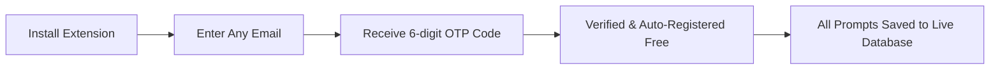

# ⚡ BlogCutter — Universal AI Prompt Saver Pro

<p align="center">
  
</p>

<p align="center">
  <strong>Never lose your AI prompts again. The 100% Free, Cloud-Synced Prompt Manager for all AI models.</strong>
</p>

<p align="center">
  <a href="https://blogcutter.com"></a>
  
  
  
</p>

---

## 🛑 The Problem: Why Prompts Get Lost

Have you ever crafted the perfect prompt, only to lose it when:
- ❌ You clear your browser cache, history, or cookies?
- ❌ Your browser crashes, updates, or resets?
- ❌ You switch computers, use a laptop on the go, or buy a new PC?
- ❌ You switch between Chrome, Brave, Edge, or different browser profiles?

Standard prompt tools only store data inside the browser's fragile local cache. Once that cache is wiped, **hours of prompt engineering work disappear forever**.

---

## 🛡️ The Solution: BlogCutter Cloud (100% Free Forever)

**BlogCutter Universal AI Prompt Saver Pro** introduces **Dual-Layer Auto-Sync**:

1. **⚡ Ultra-Fast Local Storage:** Prompts load instantly in 0 milliseconds using `chrome.storage.local`.
2. **☁️ Live Real-Time Cloud Sync:** Every prompt you create, edit, or capture is automatically mirrored to your secure [blogcutter.com](https://blogcutter.com) account.

> **Reset your browser? Switch to a new laptop? Reinstall Windows?**  
> Simply enter your email, punch in the 6-digit code, and **every single prompt is restored in seconds!**

---

## 🌟 Key Features Overview

### 1. 🌐 Universal AI Support (Works on ANY AI Site)
Built-in DOM adapters and synthetic event dispatchers automatically detect and inject prompts into:
- 🟣 **Claude AI (`claude.ai`):** Injects directly into the ProseMirror editor.
- 🟢 **ChatGPT (`chatgpt.com` / `openai.com`):** Injects into textarea and contenteditable with full React event synchronization so the Send button triggers immediately.
- 🔵 **Google Gemini (`gemini.google.com`):** Injects into rich Quill containers.
- 🐋 **DeepSeek (`chat.deepseek.com`):** Full support for DeepSeek chat textareas.
- 🟠 **Perplexity AI (`perplexity.ai`):** 1-click insertion into the search/chat input.
- 🟣 **Poe, Microsoft Copilot, Grok (xAI), Mistral Le Chat & Custom AI WebUIs:** Universal fallback identifies active inputs anywhere on the web.

### 2. 📥 1-Click Prompt Draft Capture
Crafting a complex prompt directly inside ChatGPT, Claude, or DeepSeek? Don't let it vanish after sending:
- Click the **Capture** button in the extension header or in-page launcher.
- The extension automatically extracts whatever you've typed in the active AI input box, creates a clean title, and saves it to your library and the cloud instantly!

### 3. 🧩 Dynamic Prompt Variables (`{{topic}}` & `[keyword]`)
Turn your repetitive prompts into reusable dynamic templates:
- Use `{{topic}}`, `{{audience}}`, or `[tone]` anywhere in your prompt.
- When you click **Insert**, a modal opens with dedicated fields for each variable and a **Live Compiled Preview**.
- Fill values on the fly and hit **Insert** to paste the finished prompt into your AI!

### 4. ⚡ In-Page Floating Quick Launcher (`Alt + P`)
Work at lightning speed without ever opening the extension popup:
- A subtle floating **[⚡]** widget rests near the chat input on supported AI sites.
- Press **`Alt + P`** (or click the button) to trigger an in-page search overlay.
- Search your library, click any prompt to insert it directly, or click **"Save Draft"** right from the page!

### 5. 🖥️ Chrome Side Panel Docking
- Click **Side Panel** in the extension toolbar to dock your prompt library permanently into Chrome's native Side Panel.
- Keep hundreds of prompts at your fingertips on the right side of the screen while chatting full-screen on Claude or ChatGPT.

### 6. 💾 Right-Click Context Menu (Highlight & Save)
- Found an inspiring prompt on Twitter, Reddit, GitHub, or any blog?
- Highlight the text, right-click, and select **"💾 Save selection to BlogCutter Prompts"**.
- It is saved to your library and backed up to the cloud immediately with visual badge confirmation.

### 7. 🏷️ Smart Organization & Starred Favorites
- **Category Filter Chips:** Filter in 1 click by `All`, `⭐ Starred`, `🚀 SEO`, `💻 Coding`, `✍️ Writing`, `📊 Business`, `🎨 Creative`, and `🧠 General`.
- **Sort By:** `Most Used`, `Newest First`, `⭐ Starred First`, or `A-Z`.
- **Usage Tracking:** Automatically tracks how many times each prompt has been used.

### 8. 📦 1-Click JSON Backup & Bulk Import
- **Export:** Download your entire prompt database as a standardized `.json` backup file with one click.
- **Import:** Paste JSON arrays or plain text prompts separated by double lines. Optionally sync all imported prompts to your BlogCutter cloud in bulk.

---

## 🚀 How Cloud Sync Works (Zero Setup for New Users)

You **do not** need to register beforehand on the website:



1. Open the extension and click the **Cloud** button in the header toolbar.
2. Enter your email address and click **Send Code**.
3. *New user?* Our live backend automatically creates a **100% Free BlogCutter Account** for you on the spot!
4. Check your email for the 6-digit verification code.
5. Enter the code and click **Verify & Sync**.
6. **Done!** 
   - Any prompts you saved locally will automatically upload to the cloud.
   - Any prompts saved in the future are backed up in real time to the live database.
   - If you ever switch browsers or computers, simply verify your email again to restore everything!

---

## 💻 Installation Guide

### Method: Load Unpacked in Any Chromium Browser (Chrome, Brave, Edge, Opera)

1. **Clone or Download** this repository:
   ```bash
   git clone https://github.com/YOUR_USERNAME/blogcutter-prompt-saver.git
   ```
   *(Or download and extract the ZIP file to your computer, e.g., `d:\data\chrome-ext\prompt-saver`)*

2. Open your browser and navigate to the Extensions page:
   - **Google Chrome:** `chrome://extensions/`
   - **Brave Browser:** `brave://extensions/`
   - **Microsoft Edge:** `edge://extensions/`

3. Toggle on **"Developer mode"** in the top right corner.

4. Click the **"Load unpacked"** button in the top left.

5. Select the folder where the extension files are located (`d:\data\chrome-ext\prompt-saver`).

6. Pin **BlogCutter Prompt Saver Pro** to your browser toolbar for instant access!

---

## ⌨️ Keyboard Shortcuts

| Shortcut | Action | Where |
| :--- | :--- | :--- |
| **`Alt + P`** | Toggle Floating Prompt Picker | Any AI chat page (Claude, ChatGPT, etc.) |
| **`/`** | Focus prompt search bar | Inside extension popup or side panel |
| **`Ctrl + N`** / **`Cmd + N`** | Open Create New Prompt form | Inside extension popup or side panel |
| **`Escape`** | Close open modals/panels | Anywhere inside extension |

---

## 🏗️ Technical Architecture

This extension is built in compliance with modern **Manifest V3** standards:

```text
├── manifest.json         # Manifest V3 configuration, permissions & content script matchers
├── background.js        # Background service worker (context menus, badge count & API bridge)
├── content.js           # Universal DOM injector, draft capturer & floating launcher widget
├── content.css          # In-page widget & notification toast styling
├── popup.html           # High-density UI (categories, AI detector, variables modal & cloud sync)
├── popup.js             # Client logic, fuzzy search, variable compilation & 2-way cloud sync
├── styles.css           # Premium dark theme styling with glassmorphism & responsive side panel
├── icon16.png           # 16x16 browser action icon
├── icon48.png           # 48x48 extensions management icon
├── icon128.png          # 128x128 Chrome Web Store icon
├── icon.png             # 512x512 master high-definition logo
└── CHROMEWEBSTORE.md    # Pre-submission metadata & permissions justifications for Web Store
```

### 📡 Live Backend API Integration
The extension connects silently to the live **BlogCutter** backend API (`https://blogcutter.com/api`):
- `POST /api/prompt-saver/connect` — Validates email and dispatches 6-digit OTP (auto-creates free user if new).
- `POST /api/prompt-saver/verify` — Validates OTP code, returns session and downloads all user prompts.
- `GET|POST /api/prompt-saver/prompts` — Retrieves all user prompts from the `user_prompts` database table.
- `POST /api/prompt-saver/save` — Creates or updates prompts live in the cloud.
- `POST /api/prompt-saver/delete` — Deletes prompt from cloud storage.
- `POST /api/prompt-saver/sync` — Bulk 2-way synchronization between browser and cloud.

---

## 🔒 Privacy & Security

- **Your data belongs to you:** Prompts are stored locally in your browser and only synced with your private account on `blogcutter.com`.
- **Zero Third-Party Ads or Trackers:** No analytics scripts, no tracking cookies, no advertising code.
- **Secure Authentication:** Passwordless 6-digit OTP verification ensures you never have to expose or store passwords.

---

## 📜 License

Distributed under the **MIT License**. Free for personal and commercial use.

Crafted with ❤️ by the team at [BlogCutter.com](https://blogcutter.com).

---

## 🤝 Let's Connect & Collaborate

I am open to **Senior Remote Full-Stack Roles**, **AI Platform Architecture Contracts**, and **Enterprise Technical Advisory**.

- **Timezone:** UTC+6 (Dhaka / Rangpur, Bangladesh) — Flexible overlap with US, UK, and European business hours.
- **Delivery Mode:** Async-ready, Slack, Discord, Jira, GitHub, and production-first accountability.

| Channel | Address / Handle | Quick Action |
| :--- | :--- | :--- |
| 🌐 **Primary Portfolio** | [imrandev.bd](https://imrandev.bd/) | [Visit Site ↗](https://imrandev.bd/) |
| 📦 **Packagist Packages** | [packagist.org/packages/imrandevbd/](https://packagist.org/packages/imrandevbd/) | [View Packages ↗](https://packagist.org/packages/imrandevbd/) |
| 💼 **LinkedIn Profile** | [linkedin.com/in/imranbru99](https://linkedin.com/in/imranbru99) | [Connect ↗](https://linkedin.com/in/imranbru99) |
| 🐙 **GitHub Profile** | [github.com/imranbru99](https://github.com/imranbru99) | [Follow ↗](https://github.com/imranbru99) |
| 💬 **WhatsApp Direct** | [+880 1576-918420](http://wa.me/+8801576918420) | [Chat Now ↗](http://wa.me/+8801576918420) |
| 📧 **Direct Email** | [me@imrandev.bd](mailto:me@imrandev.bd) | [Send Email ↗](mailto:me@imrandev.bd) |
| 🐦 **X (Twitter)** | [@imrandev_bd](https://x.com/imrandev_bd) | [Follow ↗](https://x.com/imrandev_bd) |
| 📺 **YouTube Tech** | [@ImranDevBD](https://youtube.com/@ImranDevBD) | [Subscribe ↗](https://youtube.com/@ImranDevBD) |

